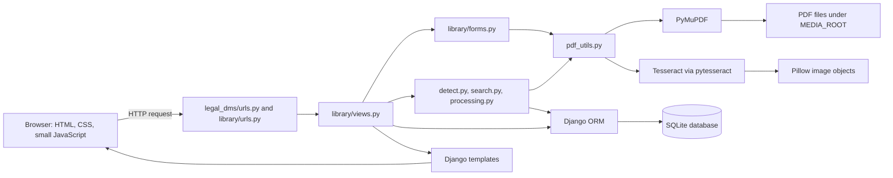
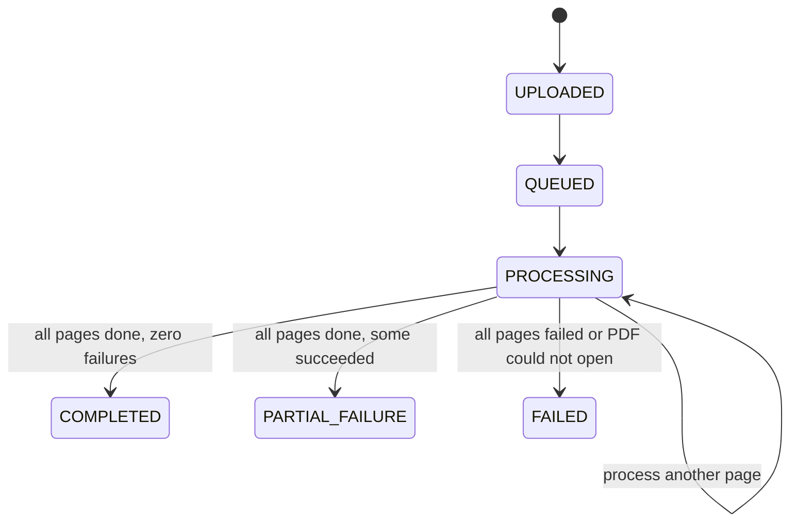

# Legal Document Workbench: Detailed Code and Flow Guide

This guide explains the code currently present in this repository: how the Django project starts, how its models fit together, what each module and function does, how a request travels through the app, and which libraries handle PDF extraction, OCR, search, and rendering.

The application is a small legal document workbench. A user uploads a PDF, the server validates it, stores the original, creates a row for each page, and extracts digital text or OCR text. The user can then search document details and page text, review or correct page text, retry failed pages, and open the original PDF.

> Read this guide together with the linked source files. Where this guide describes the running behavior, the Python and template code is the source of truth. See [Current repository gaps](#current-repository-gaps) for features that are referenced by the existing README files but are not implemented in the checked-in files.

## 1. The app in one picture

This is a Django **MTV** application: Django's Model layer stores data, its URL dispatcher routes HTTP requests to Views, and Templates render HTML. Views coordinate the models, forms, and business-logic modules.



### The main request and data flows

**Upload and extraction**

1. The upload form in `library/templates/document_form.html` lets a user select or drop a PDF.
2. JavaScript posts that file to `/upload/detect/`. `views.upload_detect` validates it, reads the first page using `pdf_utils.first_page_text`, and calls `detect.guess_details`. The response is JSON with suggestions. A field the user has already typed in is not overwritten.
3. The browser submits the complete form to `/upload/`. `UploadForm` validates the upload again; browser-side validation is only for quick feedback and is not trusted by the server.
4. `UploadForm.save` creates the `Document` row and stores the PDF using Django's `FileField` storage.
5. `processing.start_processing` marks the document queued and starts a background thread when `PROCESS_IN_BACKGROUND` is true.
6. `process_document` creates one `DocumentPage` row per PDF page. `process_page` extracts text with PyMuPDF or renders the page and sends it to Tesseract when the page has too little digital text.
7. Page status and document progress are updated. At the end, keywords are generated from the effective page text (corrected text when present, otherwise extracted text).

**Search and review**

1. The browser sends a GET request to `/` with search text and optional company, type, and status filters.
2. `SearchForm` parses the query parameters. `search.search_documents` builds a Django ORM query and returns documents matching metadata, keywords, or page text.
3. `views.index` paginates the document results and `search.add_page_hits` attaches up to three matching-page snippets to each displayed document.
4. The `index.html` template renders the results. The `highlight` template filter escapes text and wraps the matching phrase in `<mark>`.
5. A result opens `/documents/<id>/pages/<number>/`; `views.document` displays the selected page and builds its page navigator. A POST to this same URL saves or reverts a human correction.

## 2. Project layout

The Django project and application are under the `backend/` directory.

| Path | Responsibility |
|---|---|
| `manage.py` | Django command-line entry point. Sets the settings module and delegates to Django. |
| `legal_dms/settings.py` | Installed apps, middleware, template engine, SQLite, static/media paths, upload limits, OCR settings, and processing mode. |
| `legal_dms/urls.py` | Project-level URL configuration. Sends `/admin/` to Django admin and includes the `library` routes at `/`. |
| `library/urls.py` | Maps each application URL to a view function. |
| `library/models.py` | Database models and computed properties. |
| `library/forms.py` | Upload, details, and search form validation and persistence helpers. |
| `library/views.py` | HTTP request handlers and page context assembly. |
| `library/pdf_utils.py` | PDF validation, hashing, OCR threshold, OCR invocation, and first-page extraction. |
| `library/detect.py` | Rule-based company and document-type suggestions. |
| `library/processing.py` | Background processing, extraction per page, progress/status updates, and keyword persistence. |
| `library/keywords.py` | Extracts frequent searchable words from page text. |
| `library/search.py` | ORM search/filter logic, matching-page collection, and snippet creation. |
| `library/admin.py` | Registers models and configures admin list columns and filters. |
| `library/apps.py` | Django application configuration (`LibraryConfig`). |
| `library/templatetags/library_extras.py` | Custom `highlight` template filter. |
| `library/templates/` | `base.html`, `index.html`, `document_form.html`, `document.html`, and `_pager.html`. |
| `library/static/library/style.css` | Page layout, form, results, badges, page navigator, and responsive styles. |
| `library/management/commands/` | Custom `seed_sample_data` and `make_sample_pdfs` commands. |
| `library/migrations/` | Schema history: the initial models and a later removal of `Document.document_date`. |
| `requirements.txt` | Python dependency constraints. |

## 3. Framework and libraries

| Technology | What it does here |
|---|---|
| Python | Implements the application and its rules. |
| Django 5 (`Django>=5.0,<6.0`) | Web framework: URL routing, request/response handling, forms, templates, ORM, middleware, admin, messages, file uploads, and pagination. |
| SQLite | Development database, configured at `backend/db.sqlite3`. Django's ORM reads and writes its tables. |
| PyMuPDF (`pymupdf`) | Opens PDF documents, validates that PDFs can be read, counts pages, extracts embedded page text, and renders pages for OCR. |
| Tesseract OCR | External OCR engine that recognizes text in rendered page images. It must be installed separately on the machine; it is not installed by `pip`. |
| pytesseract | Python wrapper that calls the Tesseract executable and returns recognized words and confidence values. |
| Pillow (`PIL`) | Builds the image object that `pytesseract` sends to Tesseract. |
| `threading` and `time` (Python standard library) | Runs extraction in a daemon thread and measures page processing duration. |
| `hashlib`, `re`, `collections.Counter`, `pathlib`, `uuid`, `tempfile` (standard library) | Hashing, text matching/counting, path handling, unique stored filenames, and temporary sample-file workflows. |
| HTML, Django Template Language, CSS, browser JavaScript | Renders pages and implements lightweight upload suggestions, drag-and-drop, delete confirmation, highlighting, and navigation. There is no JavaScript package manager dependency. |

`pytesseract` is only the Python interface; it does not bundle the OCR binary. `TESSERACT_CMD` can point to the executable when it is not on `PATH`. `OCR_LANG` selects the Tesseract language data, and that language pack must also be installed.

## 4. Data model and relationships

All models live in [library/models.py](library/models.py). Django creates a database table for each model and provides an ORM API for querying it.

### `Company`

- Stores a company `name` (up to 200 characters, unique).
- Sorts alphabetically by name and displays as the name in forms/admin.
- A company referenced by a document is protected from deletion by the `Document.company` foreign key (`PROTECT`).

### `DocumentType`

- Stores a document type name (up to 100 characters, unique).
- Sorts by name and displays as the name.
- As with companies, a type referenced by a document cannot be deleted while the document still uses it (`PROTECT`).

### `Keyword`

- Stores one unique keyword string (up to 100 characters).
- A document can have many keywords and a keyword can be attached to many documents (`ManyToManyField`).
- Keyword rows are shared, so the same word is not duplicated for every document.

### `Document`

One row represents one uploaded PDF. Its fields include:

- `title` and `original_filename`: user-facing title and uploaded filename.
- `file`: Django `FileField` pointing to the stored PDF.
- `file_size_kb`: uploaded byte count converted to whole kilobytes, with a minimum stored value of 1.
- `sha256`: a unique SHA-256 digest used to reject duplicate file contents even if the filename changes.
- `company`, `document_type`: required foreign keys to the corresponding lookup tables.
- `page_count` and `pages_processed`: total pages and how many page rows have reached a terminal state (completed or failed).
- `status`: one of `UPLOADED`, `QUEUED`, `PROCESSING`, `COMPLETED`, `PARTIAL_FAILURE`, or `FAILED`.
- `keywords`: many-to-many association to generated keyword rows.
- `uploaded_at`: assigned automatically at creation.

Documents are ordered newest first, using upload time and then id. `pdf_path(instance, filename)` ignores the supplied filename for storage naming and returns `documents/<random-uuid>.pdf`; the original name remains in `original_filename`.

`is_working` is true while the status is uploaded, queued, or processing. `progress` calculates a rounded percentage from `pages_processed / page_count` and returns zero for a zero-page document.

### `DocumentPage`

One row represents one page of a document. Its unique constraint on `(document, page_number)` prevents duplicate page rows. Deleting a document cascades to its page rows (`CASCADE`).

- `extraction_method` is `TEXT` for embedded/digital text or `OCR` for recognized text.
- `ocr_text` holds the latest extracted result. The name is retained even for digital extraction.
- `ocr_confidence` is populated for OCR pages and is null for digital text or when no confidence can be calculated.
- `processing_status` is `PENDING`, `PROCESSING`, `COMPLETED`, or `FAILED`.
- `error_message` records page-level failures; `processing_time` records elapsed seconds.
- `corrected_text` and `is_corrected` keep a human edit separate from the extracted result.

The `text` property returns `corrected_text` only when `is_corrected` is true; otherwise it returns `ocr_text`. Search and keyword generation use this property, so a human correction becomes the active text without destroying the original extraction.

### Status transition overview



For page rows, a successful read ends at `COMPLETED`; an exception ends at `FAILED`. Retrying a page can change a failed page back to completed. The document progress updater counts both completed and failed pages as processed. A PDF open failure is recorded at document level as `FAILED` and returns before page-by-page progress is recalculated.

## 5. URL and screen reference

The root URL file is [legal_dms/urls.py](legal_dms/urls.py); it includes [library/urls.py](library/urls.py). The integer URL arguments named `pk` identify a `Document` primary key; `number` is a 1-based page number.

| Method and URL | View | Purpose |
|---|---|---|
| `GET /` | `index` | Main list, text search, and metadata filters. |
| `GET /upload/` | `upload` | Renders the upload form. |
| `POST /upload/` | `upload` | Validates, saves, starts processing, then redirects to the document. |
| `POST /upload/detect/` | `upload_detect` | Validates a selected file and returns first-page suggestions as JSON. |
| `GET /queue/` | `queue` | Queries documents that are not completed and tries to render `queue.html` (currently absent; see gaps below). |
| `GET /documents/<pk>/` | `document` | Shows page 1 of a document. |
| `GET /documents/<pk>/pages/<number>/` | `document` | Shows the selected page and optional search highlights. |
| `POST /documents/<pk>/pages/<number>/` | `document` | Saves an edited page text or reverts to extracted text. |
| `GET /documents/<pk>/edit/` | `edit_details` | Renders existing title, company, and type values. |
| `POST /documents/<pk>/edit/` | `edit_details` | Validates and saves updated metadata. |
| `POST /documents/<pk>/delete/` | `delete_document` | Checks the configured password, then removes the document record and stored PDF. |
| `POST /documents/<pk>/pages/<number>/retry/` | `page_retry` | Retries extraction synchronously for the selected page. Non-POST requests only redirect. |
| `GET /documents/<pk>/pdf/` | `document_pdf` | Streams the stored PDF through Django rather than exposing its disk path. |
| `GET /admin/` | Django admin | Built-in management UI for registered models (requires a Django admin user). |

## 6. Function-by-function explanation

### `manage.py`

- **`main()`**: sets `DJANGO_SETTINGS_MODULE` to `legal_dms.settings`, imports Django's command runner, and passes it the command-line arguments. This is how `runserver`, `migrate`, `createsuperuser`, and custom management commands start.

### `library/models.py`

- **`Company.__str__()` / `DocumentType.__str__()` / `Keyword.__str__()`**: return the stored name or word so Django admin, forms, and debug output show a readable label.
- **`pdf_path(instance, filename)`**: generates a random UUID filename under the `documents/` media subdirectory. It makes stored names hard to collide and avoids using the original name as the storage path.
- **`Document.__str__()`**: returns the title.
- **`Document.is_working`**: computed property that groups the three in-progress document states for templates.
- **`Document.progress`**: computed percentage; it handles a missing/zero page count safely.
- **`DocumentPage.__str__()`**: identifies a page as `<document title> / page <number>`.
- **`DocumentPage.text`**: chooses the corrected text when `is_corrected` is true; otherwise chooses extracted text. This is the common read path used by keyword generation and snippets.

### `library/forms.py`

- **`clean_name(value)`**: collapses repeated spaces, tabs, and line breaks into single spaces and trims the result. Used for titles, company names, and type names.
- **`get_or_create_named(model, name)`**: normalizes a name, finds an existing row with a case-insensitive match, or creates a row. The caller supplies either `Company` or `DocumentType` as `model`.
- **`check_upload(filename, data)`**: runs `pdf_utils.check_pdf`, computes a SHA-256 digest, and searches for an existing `Document` with that digest. Returns `(page_count, sha256)` or raises `ValueError` with a user-readable validation message.
- **`DetailsForm.clean_title()` / `clean_company()` / `clean_document_type()`**: normalize each value after Django has checked the field constraints.
- **`DetailsForm.apply_to(document)`**: copies the cleaned title onto a `Document`; resolves or creates its company and document type.
- **`UploadForm.clean()`**: after normal form cleaning, if a file was supplied and the title is blank, uses the uploaded filename without its extension as the title. It runs Django's title field validation on that fallback.
- **`UploadForm.clean_file()`**: reads the upload into memory to validate/hash it, seeks the uploaded file back to byte zero so it can still be saved, then keeps page count, SHA-256, and byte size on the form instance for `save()`.
- **`UploadForm.save()`**: constructs a `Document` from the uploaded file and validation results, applies title/company/type fields, saves it, and returns it. It does not start OCR; the view calls `start_processing` afterward.
- **`SearchForm.__init__()`**: configures the query placeholder/autofocus and adds an `onchange` handler to the company, type, and status selectors so changing one immediately submits the GET form.

`DetailsForm` is reused by upload and edit. `UploadForm` extends it with a file field and upload-specific validation. `SearchForm` uses `ModelChoiceField` values for company and document type, so the selected values are actual database objects rather than free text.

### `library/pdf_utils.py`

- **`sha256_of(data)`**: returns a hex-encoded SHA-256 fingerprint of the complete PDF byte sequence.
- **`check_pdf(filename, data)`**: checks, in order, the `.pdf` suffix, non-empty content, maximum size from settings, `%PDF-` signature after leading whitespace, whether PyMuPDF can open the bytes, password protection, and non-zero page count. Raises `ValueError` on the first failed check; otherwise returns the page count. This checks file shape and readability; it is not a full malware/content scanner.
- **`page_needs_ocr(text)`**: counts letters/digits with `str.isalnum()` and returns true if the count is below `OCR_MIN_CHARS`. Punctuation and whitespace do not count. This simple threshold is the decision rule for scanned-page handling.
- **`ocr_page(page)`**: renders a PyMuPDF page at `OCR_DPI`, creates a Pillow RGB image, optionally sets the Tesseract executable path, then calls `pytesseract.image_to_data`. It groups recognized words by block/paragraph/line to reconstruct line breaks. It excludes empty words and negative confidence values, averages remaining word confidences, and returns `(recognized_text, confidence_or_none)`.
- **`first_page_text(data)`**: opens PDF bytes, extracts page 1 text, and runs OCR if the same threshold says the page is likely scanned. It returns an empty string if opening, text extraction, or OCR raises an exception; this helper is used for optional suggestions, not as the final full-document processing record.

### `library/detect.py`

- **`TYPE_HINTS`**: maps built-in document type labels (Mortgage, Power of Attorney, Affidavit, Lease, Legal Notice, Court Order, Invoice, Deed, Contract, Letter) to words/phrases used to identify them.
- **`COMPANY_SUFFIX` / `COMPANY_PATTERN`**: regex rules for company names ending in forms such as `Pvt Ltd`, `Limited`, `LLP`, `LLC`, `Inc`, `Corporation`, `Company`, or `Bank`. The regex allows up to five capitalized name tokens before the suffix.
- **`guess_company(text, known=())`**: first searches the page text for any known company name, case-insensitively, and returns the one appearing earliest in the text. If none match, extracts names matching the suffix regex, normalizes whitespace, removes selected leading filler words, and chooses the most frequently found candidate; first occurrence wins a tie. Returns an empty string when no candidate is found.
- **`guess_type(text, known=())`**: copies the built-in hints and adds custom known types as their own lowercase phrase. It scores occurrences in the first 1,500 characters, weighting occurrences in the first 200 characters three extra times. The highest score wins; ties follow dictionary insertion order. If a known database type wins, its original capitalization is returned. Returns empty string if every score is zero.
- **`guess_details(text, filename="", companies=(), types=())`**: combines the title from `Path(filename).stem` with `guess_company` and `guess_type`, returning a dictionary suitable for form initial values/JSON fields.

These detection rules are suggestions. The user can edit the results, and normal upload still validates required values.

### `library/keywords.py`

- **`STOP_WORDS`**: common English words and the word `page` that do not make useful search tags.
- **`top_keywords(text, how_many=10)`**: lowercases the input, extracts alphabetic words containing at least three letters, removes stop words, counts the remaining words with `Counter`, and returns up to ten most common terms in frequency order. Numbers and mixed alphanumeric tokens do not become tags.

### `library/processing.py`

- **`start_processing(document)`**: updates the saved document to `QUEUED`, then either starts `_in_thread(document.pk)` as a daemon thread or runs `process_document` immediately, depending on `PROCESS_IN_BACKGROUND`.
- **`_in_thread(document_id)`**: calls `process_document` and closes the thread's Django database connection in a `finally` block so a worker thread does not leave its own connection open.
- **`process_document(document_id)`**: fetches the document, marks it processing, finds which page numbers already have rows, and bulk-creates missing `DocumentPage` rows. It opens the stored PDF. If opening fails, it marks the document failed and returns. Otherwise it processes every page not already completed, calling `refresh_progress` after each. It then regenerates document keywords. Existing completed page rows are skipped, which makes this routine usable for resuming incomplete work.
- **`process_page(document, number, pdf=None)`**: retrieves one page row and marks it processing. It reuses a supplied open PDF or opens/closes its own. It reads digital text; if the page is below the OCR threshold, runs OCR and records OCR method/confidence, else records digital-text method and clears confidence. On success it saves text and marks the row complete; on exception it saves the error string and marks it failed. It records elapsed time and deliberately does not include `corrected_text` in the fields saved, preserving human edits. Returns the updated page row.
- **`refresh_progress(document)`**: aggregates how many pages are completed or failed and how many failed. It compares the terminal count to `page_count`, then sets document status to processing, completed, failed, or partial failure. It writes the terminal count into `pages_processed`.
- **`save_keywords(document)`**: joins each page's effective `page.text`, runs `top_keywords`, gets or creates corresponding `Keyword` rows, and replaces the document's keyword associations with the new set.

### `library/search.py`

- **`page_has_text(term)`**: returns a Django `Q` expression that searches `ocr_text` only when the page is not corrected, or `corrected_text` only when it is corrected. This mirrors `DocumentPage.text` without asking the database to call a Python property.
- **`search_documents(filters)`**: starts with documents plus related company/type and prefetched keywords. Applies company/type/status filters when supplied. For a search term, checks case-insensitive containment in title, filename, company, type, keywords (`Exists` subquery), or page text (`Exists` subquery). If the term contains only digits, also checks for an exact document primary key. It returns a lazy QuerySet; it does not render HTML or paginate.
- **`matching_pages(filters)`**: returns no page rows when there is no search term; otherwise returns page rows matching the effective text expression.
- **`add_page_hits(documents, filters, show=3)`**: for just the displayed documents, counts matching page rows per document, attaches at most `show` page rows as `doc.hits`, adds each row's snippet, and sets `doc.more_hits` to the remaining count. These are temporary Python attributes for the template, not database columns.
- **`make_snippet(text, term, width=80)`**: collapses whitespace, finds the first case-insensitive occurrence, and returns roughly 80 characters before and after it with ellipses when clipped. If the phrase is absent or empty, returns the first 160 characters.

Search uses `icontains`, so multiple words are matched as one contiguous phrase. The `Exists` queries avoid multiplying document rows when many pages/keywords match.

### `library/views.py`

- **`paginate(request, items, per_page=PER_PAGE)`**: creates a Django `Paginator`, obtains the requested page using `get_page` (which falls back safely for invalid page values), removes `page` from a copy of the query parameters, and returns `(page_object, remaining_query_string)` for pager links.
- **`index(request)`**: binds `SearchForm` to query parameters, uses cleaned filters if valid, searches and paginates documents, computes matching-page hits for the current page of results, then renders `index.html` with the form, results, query, and search-state flag.
- **`form_page(request, form, document=None)`**: shared renderer for upload/edit form pages. Supplies all existing companies and types for their HTML datalists.
- **`upload(request)`**: handles GET by rendering a blank `UploadForm`; handles valid POST by saving the form, starting processing, adding a success message, and redirecting to the new document. Invalid POST re-renders field errors.
- **`upload_detect(request)`**: accepts only POST due to `@require_POST`. If there is no uploaded file, returns JSON error. Otherwise reads bytes and calls `check_upload`; validation errors become JSON errors. On success it reads first-page text and calls `guess_details` with known company/type names, then returns JSON containing page count and suggestions.
- **`edit_details(request, pk)`**: loads a document or returns 404, builds initial values from its current metadata, validates a `DetailsForm` on POST, applies/saves changed values, then redirects with a success message. On GET or invalid POST, renders the shared form.
- **`delete_document(request, pk)`**: accepts only POST due to `@require_POST`. Checks the submitted password against `DOCUMENT_DELETE_PASSWORD_HASH`; invalid passwords produce a message and redirect. With a valid password, captures the storage/file name, deletes the model row and file within a database transaction, and handles `OSError` with an error message. Successful deletion also cascades to pages and removes database associations.
- **`queue(request)`**: selects documents whose status is not completed, paginates 25 per page, and renders `queue.html`, passing a refresh flag if a document on that page is still active. The expected template is not present in this repository snapshot.
- **`document(request, pk, number=None)`**: loads the document and related company/type or returns 404; defaults to page 1 and rejects page numbers beyond the document page count. On POST, either clears the human correction (`revert`) or saves submitted text as corrected text, regenerates keywords, and redirects. On GET, optionally finds all matching pages for the `q` term, selects a 60-page navigator block, creates page tiles with status/hit information, and passes editing state, previous/next block links, next match, match count, and failure count to `document.html`.
- **`page_retry(request, pk, number)`**: loads the document. On POST, calls `process_page`, recomputes document progress/status and keywords, and adds a message; then redirects to the selected page. The route itself does not use `@require_POST`, but only POST triggers processing.
- **`document_pdf(request, pk)`**: looks up the document and returns a Django `FileResponse` streaming the PDF with an `application/pdf` content type and original filename.

### `library/templatetags/library_extras.py`

- **`highlight(text, term)`**: registered as the Django template filter `highlight`. Escapes the page/snippet text first to prevent user text from becoming HTML, escapes and regex-quotes the search term, then wraps case-insensitive occurrences in `<mark>`. Returns safe HTML only after escaping the source text.

### `library/admin.py` and `library/apps.py`

- `Company`, `DocumentType`, and `Keyword` are registered directly with Django admin.
- **`DocumentAdmin`** shows id, title, company, type, page count, and status in the list and offers filters by status/company/type.
- **`DocumentPageAdmin`** shows document, page number, extraction method, processing status, and correction flag; filters by status and method.
- **`LibraryConfig`** tells Django that the app package is named `library`.

### Management command handlers

Both custom commands subclass Django's `BaseCommand`; `handle(self, *args, **options)` is Django's entry point for the command.

- **`seed_sample_data.Command.handle()`**: creates the built-in document types if missing, creates temporary sample PDF files, applies the same detection/upload form path to each sample, saves valid documents, processes them synchronously, and reports the result. It imports constants and `text_pdf` from `library.sample_pdfs`.
- **`make_sample_pdfs.Command.handle()`**: creates a `sample_pdfs/` folder in the current working directory and asks `text_pdf`/`scanned_pdf` to write three digital PDFs and one scanned-style PDF. It also imports those helpers from `library.sample_pdfs`.

The imported `library.sample_pdfs` module is absent from the current file tree; see the gap list below.

### Browser-side JavaScript functions

The browser code is embedded directly in Django templates; it is not a separate frontend package.

- In `document_form.html`, **`box(name)`** finds the form field wrapper with the matching `data-field` value; **`input(name)`** returns the input inside that wrapper.
- **`say(name, text, type)`** clears an earlier upload hint/error under a field, creates a new paragraph when the message is non-empty, assigns status classes, and inserts it as text (not raw HTML).
- The file input's `change` handler posts the selected file to the detect endpoint, displays progress/errors, and fills suggestions only for fields the user has not manually touched.
- The dropzone's `dragover`, `dragleave`, and `drop` handlers provide visual feedback, assign the dropped file to the file input, and reuse the same `change` flow.
- In `index.html`, **`confirmDocumentDelete(form)`** prompts for the configured delete password and asks for confirmation. If both are accepted, it copies the password into the hidden form field and lets the POST continue; otherwise it cancels submission. The server still validates the password.

## 7. Settings and configuration

Settings live in [legal_dms/settings.py](legal_dms/settings.py).

| Setting | Current behavior |
|---|---|
| `BASE_DIR` | Resolves to the `backend/` project directory. |
| `DEBUG` | `False`. |
| `ALLOWED_HOSTS` | Allows `localhost` and `127.0.0.1`. |
| `INSTALLED_APPS` | Django admin/auth/contenttypes/sessions/messages/staticfiles plus `library`. |
| `MIDDLEWARE` | Security, sessions, common request handling, CSRF, authentication, and flash messages. |
| `DATABASES` | SQLite at `BASE_DIR / "db.sqlite3"`, with a 20-second lock timeout. |
| `TIME_ZONE`, `USE_TZ` | Uses `Asia/Kolkata` with timezone-aware datetimes. |
| `STATIC_URL` | URL prefix for CSS/static assets. |
| `MEDIA_ROOT`, `MEDIA_URL` | Filesystem root and URL prefix for uploaded files. The PDF view streams files through Django. |
| `MAX_UPLOAD_SIZE_MB` | Maximum upload size: 50 MB. |
| `OCR_MIN_CHARS` | Fewer than 20 alphanumeric characters triggers OCR. |
| `OCR_DPI` | OCR page render resolution: 300 DPI. |
| `OCR_LANG` | Tesseract language code: `eng`. |
| `TESSERACT_CMD` | Empty means pytesseract searches for Tesseract on `PATH`. |
| `PROCESS_IN_BACKGROUND` | `True`, so processing is started in a daemon thread. |
| `DOCUMENT_DELETE_PASSWORD_HASH` | Password hash checked by the delete view. The plaintext password is not in the view. |

The settings file contains a hard-coded development secret and delete-password hash. The guide does not repeat their values; configuration should be handled carefully if this app is prepared for a real deployment.

## 8. Database schema history

`library/migrations/0001_initial.py` creates the initial models and includes a `document_date` field on `Document`. `0002_remove_document_document_date.py` removes that field. The current `Document` model has no `document_date`; running all migrations in order yields the current schema. After intentional model changes, Django's normal workflow is `makemigrations` followed by `migrate`.

## 9. Template and interface behavior

- **`base.html`**: shared HTML shell, static CSS, top bar and upload link, Django message display, and the content/head blocks.
- **`index.html`**: GET search form, filters, paginated document table, keyword tags, matching page snippets, progress/status display, and delete POST form.
- **`document_form.html`**: reused for upload and edit; displays server-side field errors and datalists. On upload only, client-side JavaScript calls `/upload/detect/` and supports drag/drop.
- **`document.html`**: document metadata and PDF link, page status/progress, keyword tags, page tiles in blocks of 60, search/highlight controls, edit/revert form, failed-page retry form, and previous/next page links. A meta refresh every three seconds is included while the document is working and the user is not editing.
- **`_pager.html`**: previous/next links for paginated document lists. It carries forward other GET parameters through `querystring`.
- **`style.css`**: plain responsive styling for forms, tables, status badges, progress bar, snippets, page tiles, and smaller screens. It contains presentation rules rather than application logic.

## 10. A concrete upload example

Suppose a user selects `contract.pdf`:

1. Browser `change` event submits the file and CSRF token to `upload_detect`.
2. `check_upload` calls `check_pdf`, which checks extension, bytes, size, signature, readability, password protection, and page count. It then hashes the bytes and checks the database for a duplicate.
3. `first_page_text` extracts page 1 text with PyMuPDF, or OCRs it if fewer than 20 letters/digits were extracted.
4. `guess_details` proposes `contract` as the title from the filename; `guess_company` and `guess_type` examine the first-page text.
5. The browser inserts suggestions only into fields untouched by the user.
6. The final multipart form POST repeats file validation. `UploadForm.save` creates lookup rows as necessary and saves the document record and PDF.
7. The view redirects to the document. The worker creates page rows, extracts each page, records timing/status, and refreshes document progress.
8. Search and keyword generation read from `DocumentPage.text`, meaning corrected text takes priority after a manual edit.

## 11. Current repository gaps

These points describe files and references in the current workspace snapshot. They are useful to mention when walking someone through the code because some README descriptions imply those paths already work.

1. **Queue screen template missing:** `views.queue` renders `queue.html`, but the `library/templates/` directory contains no `queue.html`. Requesting `/queue/` will fail when Django tries to render that missing template.
2. **Sample PDF helper module missing:** both management commands import `library.sample_pdfs`, but there is no `library/sample_pdfs.py` in the application tree. The `seed_sample_data` and `make_sample_pdfs` commands therefore cannot import their dependencies as currently checked in.
3. **README feature/tree drift:** the README files refer to a queue template and `sample_pdfs.py` that are absent. `README.md` also says to run tests, but no test modules/files are present in the scanned project tree.
4. **Migration history has an intentionally removed field:** the initial migration contains `document_date`, while the current model does not; the next migration removes it. This is expected migration history, not a current model field.

This guide documents those gaps; it does not add the missing runtime files.

## 12. Running the app (reference)

Run commands from the `backend/` directory. The dependencies are declared in `requirements.txt`; Tesseract itself must be installed separately for scanned PDFs.

```powershell
python -m venv env
env\Scripts\Activate.ps1
pip install -r requirements.txt
python manage.py migrate
python manage.py runserver
```

The sample commands described in the README depend on the missing `library.sample_pdfs` module noted above. A successful `migrate` creates/updates the SQLite schema; `runserver` starts Django's development HTTP server.

## 13. Short explanation for presenting the project

> “This is a Django legal-document workbench. Django handles routes, forms, templates, database access, and uploads. The app stores each PDF as a document and creates one database record per page. PyMuPDF reads embedded text and renders pages; when a page has less than the configured amount of text, pytesseract calls Tesseract to OCR it. Processing status and OCR confidence are saved. Search combines document metadata, generated keywords, and each page's effective text. A correction is stored separately so retries preserve it. The current snapshot still has a missing queue template and missing sample-PDF helper module, which are called out in the code guide.”
