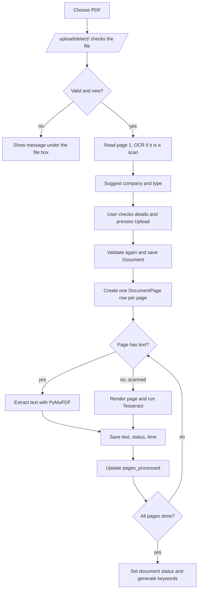
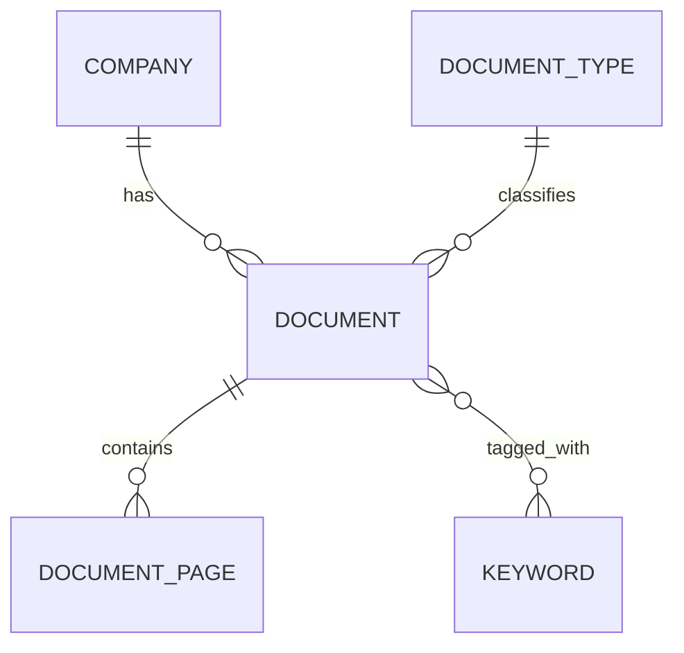

# Legal Document Workbench

A small Django application for a legal document management system. You upload a PDF, the app reads it page by page (digital text where it exists, OCR for scanned pages), suggests the company and document type, and then lets you **search every page of every document from one screen** and review the matching pages with the search term highlighted.

It covers two tasks in one codebase:

- **Task 1, Document Intake & OCR Workbench:** upload, validate, extract text page by page, review and correct the text, retry a single failed page.
- **Task 2, Legal Document Search & Review Workbench:** search documents by metadata and by the text inside pages, filter, and review matching pages.

Core document functions do **not** use an LLM. Detection, keyword generation and search are plain, readable Python rules.

> Stack: Python 3.11+, Django 5, SQLite (development), PyMuPDF, Tesseract OCR, plain CSS and a little JavaScript. No Node.js and no CDN, so it also runs offline.

---

## Contents

1. [Features](#features)
2. [Screens](#screens)
3. [How it works](#how-it-works)
4. [Getting started](#getting-started)
5. [Configuration](#configuration)
6. [Data model](#data-model)
7. [Routes](#routes)
8. [Code layout](#code-layout)
9. [Testing](#testing)
10. [Design decisions](#design-decisions)
11. [Limitations and next steps](#limitations-and-next-steps)
12. [Troubleshooting](#troubleshooting)
13. [Task checklist and notes for merging](#task-checklist-and-notes-for-merging)

---

## Features

**Intake**
- PDF upload with drag and drop. Title, company and document type are suggested from the PDF and can be changed.
- Upload time is recorded automatically.
- Validation with clear messages: file extension, real PDF signature, size limit, corrupt file, password-protected file, page count, and duplicate detection by SHA-256 (a renamed copy is still caught).
- Live progress while pages are read (for example `120 / 384`).

**Extraction and OCR**
- Digital PDFs: text is taken directly with PyMuPDF.
- Scanned pages: pages with almost no text are rendered to an image and sent to Tesseract. The average OCR confidence is stored.
- One database row per page, with its own status, error message and processing time.
- A failed page does not stop the document. Retry one page without reprocessing the rest.

**Search and review**
- One main screen is both the document list and the search. There is no separate search page.
- The search box looks in title, file name, company, document type, keywords, document ID and the text of every page.
- Documents that match on page text show the matching pages right under the title, with a highlighted snippet.
- Company, type and status filters combine with the search text.
- A document screen with a page navigator, highlighted search term, previous/next page and next match.

**Editing and housekeeping**
- Edit the extracted text of any page. The original OCR text is kept and a person's version is stored separately.
- Edit title, company and type of a document at any time.
- Company and type are free-text boxes with a dropdown of existing names. A new name is created when you save.
- Keywords are generated automatically (word counting, no LLM).
- Delete a document (PDF and all extracted page data) with a password check on the server.

---

## Screens

| Screen | Address | What it does |
|---|---|---|
| Documents | `/` | The document list and the search. One box and three dropdown filters. |
| Upload | `/upload/` | Choose a PDF. Title, company and type are suggested from it. |
| Edit details | `/documents/<id>/edit/` | Change title, company and type. Same form as upload, without the file. |
| Processing queue | `/queue/` | Documents that are still being read or had a problem, with progress bars. |
| Document | `/documents/<id>/` | Details, page navigator, page text, edit text, retry, previous/next. |

### Documents (main page)

- With nothing typed, you get a paginated table of all documents, newest first (10 per page, paginated on the server).
- Type in the box and press Search. Results are still documents, but each one can carry **matching pages**:

  ```
  Service Agreement                              Acme Industries Ltd   Contract   3   Completed
  AE6011.pdf   [payment] [invoice] [agreement]
    Page 2  ...shall pay each invoice within <mark>forty five days</mark>. Late payment will...
    Page 3  ...
    + 2 more matching pages
  ```

- Clicking a snippet opens that exact page with the term highlighted. Clicking "more matching pages" opens the document with all matching pages marked in the navigator.
- The company, type and status dropdowns apply as soon as you change them.
- Keyword tags on a row use the main search box when clicked.
- A single document is listed once, however many of its pages match.

### Upload

1. Choose or drop a PDF.
2. The page sends the file to the server, which validates it and reads the first page. Any validation error appears immediately under the file box.
3. Title, company and type are filled in as suggestions. A field you have already typed in is never overwritten.
4. Check or change the values and press Upload. Reading of the pages starts and you land on the document screen.

### Document screen

- **Header:** title, status badge, company, type, page count, file name, upload time, document ID, link to the original PDF, and an Edit details button.
- **Page navigator:** page numbers in blocks of 60, colored by status (completed, failed, pending). Pages that contain the search term are underlined.
- **Page panel:** page status, extraction method (digital text or OCR), OCR confidence, processing time, and whether the text was edited by a person.
- **Find in this document**, **Next match**, Previous and Next.
- **Edit text** opens the page text in an editor. Saving stores it as the corrected version. "Back to extracted text" discards the correction.
- **Retry this page** appears on a failed page with the error message.
- While a document is being read the page refreshes by itself every 3 seconds (not while you are editing).

### Processing queue

Lists every document that is not completed, with status and a progress bar. It refreshes itself while any document is still being read.

---

## How it works

### Upload and processing



### Validation rules (`pdf_utils.check_pdf`)

| Check | Message the user sees |
|---|---|
| Not a `.pdf` extension | Only .pdf files are accepted. |
| Empty file | The file is empty. |
| Over the size limit | The file is too large (limit is N MB). |
| Does not start with `%PDF-` | This is not a real PDF. The content is not PDF data. |
| PDF library cannot open it | The PDF is corrupt or cannot be read. |
| Needs a password | The PDF is password protected. Remove the password and upload it again. |
| Zero pages | The PDF has no readable pages. |
| Same SHA-256 as an existing document | This file is already in the system as "Title" (document N). |

The same checks run twice: once when the file is chosen (so you see the problem immediately) and again when you press Upload (so the server never trusts the browser).

### Page processing (`processing.py`)

- A page is treated as a scan when it has **fewer than `OCR_MIN_CHARS` letters and digits**. Those pages are rendered at `OCR_DPI` and read by Tesseract. Other pages use their digital text.
- If a page fails, the error is stored on that page and the document carries on.
- Document status is calculated from the pages:

  | Situation | Status |
  |---|---|
  | Pages still waiting | Processing |
  | All pages done, none failed | Completed |
  | All pages done, some failed | Partial failure |
  | All pages done, all failed | Failed |

- Running `process_document` again only redoes pages that are not completed.
- Retrying one page (`process_page`) never touches `corrected_text`, so a person's edit survives a retry.
- Processing runs in a background thread so the upload returns quickly. The functions do not depend on the views, so they can move to Celery later.

### Suggested details (`detect.py`)

The first page is read (with OCR if needed) and two values are suggested. They are only suggestions, and a wrong guess costs nothing.

| Value | Rule |
|---|---|
| **Title** | The uploaded file name without `.pdf`. No title is taken from the page text. |
| **Company** | A company already in the system whose name appears on the page. Otherwise the most frequent name that ends in `Pvt Ltd`, `Private Limited`, `Limited`, `Ltd`, `LLP`, `LLC`, `Inc`, `Corp`, `Corporation`, `Company` or `Bank`. |
| **Document type** | The type the page talks about most. Words come from `TYPE_HINTS` (mortgage, power of attorney, affidavit, lease, legal notice, court order, invoice, deed, contract/agreement, letter). A phrase in the first 200 characters counts three times. On a tie the more specific type wins. Types already in the database are matched too, and their spelling is reused. |

To teach it a new type, add a line to `TYPE_HINTS` in `library/detect.py`.

### Company and type

Both are text boxes backed by a list of existing names.

- Pick an existing name or type a new one. A new name is **created when you save**, and appears in the dropdown and in the search filters from then on.
- Names are compared ignoring upper/lower case and extra spaces, so typing `acme   industries` reuses `Acme Industries` instead of creating a copy.
- Nothing is created if the upload is rejected.

### Search (`search.py`)

All search logic is in `search.py` and contains no HTML.

- **Text:** the search text is matched (case-insensitive "contains") against title, file name, company name, document type name, keywords, and the text of every page. A number also matches the document ID.
- **Phrase search:** several words are searched as an exact phrase. `property tax` finds "property tax" but not "tax on property".
- **Corrected text wins:** if a person fixed a page, the corrected text is searched, otherwise the OCR text.
- **Filters:** company, document type and status are applied together with the text.
- **No duplicates:** page and keyword matches use `EXISTS` subqueries, so a document appears once even if 50 pages match.
- **Snippets:** for the documents on the current page of results, the first 3 matching pages are loaded with a snippet of about 80 characters on each side of the match. The rest are counted ("+ N more matching pages").

### Keywords (`keywords.py`)

Lowercase the text, take words of three or more letters, remove common words, count with `collections.Counter`, keep the 10 most frequent. Keywords are regenerated when a document finishes processing, when a page is retried, and when a page is edited. They appear as tags and are searchable.

### Deleting a document

Each document has a **Delete** button that permanently removes the PDF file and all extracted page data. The password is checked on the server against a hash stored in `legal_dms/settings.py` as `DOCUMENT_DELETE_PASSWORD_HASH` (see [Configuration](#configuration)).

---

## Getting started

### Prerequisites

- Python 3.11 or newer
- [Tesseract OCR](https://github.com/tesseract-ocr/tesseract) installed

| OS | Install |
|---|---|
| Windows | Installer from <https://github.com/UB-Mannheim/tesseract/wiki>, then add it to PATH or set `TESSERACT_CMD` |
| macOS | `brew install tesseract` |
| Ubuntu/Debian | `sudo apt install tesseract-ocr` |

Check it with `tesseract --version`.

### Setup

```bash
cd backend
python -m venv env
source env/bin/activate            # Windows: env\Scripts\activate
pip install -r requirements.txt
python manage.py migrate
python manage.py seed_sample_data
python manage.py createsuperuser   # optional, for /admin/
python manage.py runserver
```

Open <http://127.0.0.1:8000>.

A migration file is included. If you change `models.py`, run `python manage.py makemigrations library` and migrate again.

### Sample data

| Command | What it does |
|---|---|
| `python manage.py seed_sample_data` | Adds the usual document types and three small documents (service agreement, legal notice, mortgage deed). They go through the same detect-and-save steps as a real upload. |
| `python manage.py make_sample_pdfs` | Writes four test PDFs (three digital, one scanned) to `sample_pdfs/` so you can try the upload screen yourself. |

Good things to try after seeding:

- Search `property tax`, `forty five days`, `Zenith`, `Mortgage`, or a document ID.
- Upload `sample_pdfs/scanned_letter.pdf` to watch the OCR path and see a confidence value.
- Upload the same file twice (or under another name) to see the duplicate message.
- Type a company that does not exist and check that it shows up in the dropdown on the next upload.

---

## Configuration

Settings live in `legal_dms/settings.py`.

| Setting | Meaning |
|---|---|
| `MAX_UPLOAD_SIZE_MB` | Largest PDF accepted. |
| `OCR_MIN_CHARS` | A page with fewer letters/digits than this is treated as a scan and sent to OCR. |
| `OCR_DPI` | Resolution used when a page is rendered for OCR. Higher is more accurate and slower. |
| `OCR_LANG` | Tesseract language code, for example `eng`. |
| `TESSERACT_CMD` | Full path to the Tesseract program. Leave empty if it is on your PATH. |
| `PROCESS_IN_BACKGROUND` | `True` reads pages in a background thread. `False` reads them during the request (used by the tests). |
| `DOCUMENT_DELETE_PASSWORD_HASH` | Hash of the password needed to delete a document. |

To create a hash for the delete password:

```bash
python manage.py shell -c "from django.contrib.auth.hashers import make_password; print(make_password('your-password'))"
```

Paste the output into `DOCUMENT_DELETE_PASSWORD_HASH`. Do not commit a real password or a production hash to a public repository; read it from an environment variable instead.

For local development, `DJANGO_DEBUG` defaults to `true`, so `runserver` serves the CSS. Before deployment, set the `DJANGO_DEBUG` environment variable to `false`, change `SECRET_KEY`, and set `ALLOWED_HOSTS` for the deployment host.

---

## Data model

Shared by both tasks: intake writes it, search and review read it.



### Document

| Field | Type | Notes |
|---|---|---|
| `id` | PK | The document ID shown in the UI and searchable. |
| `title` | text | Defaults to the file name without `.pdf`. Editable. |
| `original_filename` | text | The name the user uploaded. Searchable. |
| `file` | file | Stored under a random name, `documents/<uuid>.pdf`. The path is never sent to the browser. |
| `file_size_kb` | integer | |
| `sha256` | char(64), unique | Duplicate detection. |
| `company` | FK to Company | |
| `document_type` | FK to DocumentType | |
| `page_count` | integer | Set at validation. |
| `pages_processed` | integer | Live progress count. |
| `status` | choice | Uploaded, Queued, Processing, Completed, Partial failure, Failed. |
| `keywords` | many-to-many to Keyword | Generated automatically. |
| `uploaded_at` | datetime | Set automatically. |

### DocumentPage

Unique on `document` + `page_number`.

| Field | Type | Notes |
|---|---|---|
| `document` | FK to Document | |
| `page_number` | integer | Starts at 1. |
| `extraction_method` | choice | `TEXT` (digital) or `OCR`. |
| `ocr_text` | text | The extracted text. Replaced only by a re-read, never by a person's edit. |
| `ocr_confidence` | float, nullable | OCR pages only. |
| `processing_status` | choice | Pending, Processing, Completed, Failed. |
| `error_message` | text | Why a page failed. |
| `processing_time` | float | Seconds. |
| `corrected_text` | text | A person's edited version. |
| `is_corrected` | boolean | True after a person saves. |

The property `DocumentPage.text` returns `corrected_text` when `is_corrected` is true, otherwise `ocr_text`. Search, keywords and the review screen all use it.

### Company, DocumentType, Keyword

Each has a unique name (`name`, or `word` for keywords).

---

## Routes

| Method | Address | Purpose |
|---|---|---|
| GET | `/` | Document list and search. Query parameters: `q`, `company`, `document_type`, `status`, `page`. |
| GET, POST | `/upload/` | Upload form. |
| POST | `/upload/detect/` | Called by the upload page when a file is chosen. Returns JSON with either `error`, or `pages`, `title`, `company`, `document_type`. |
| GET | `/queue/` | Processing queue. |
| GET | `/documents/<id>/` | Document screen (page 1). Optional `?q=` highlights a term. |
| GET, POST | `/documents/<id>/edit/` | Edit title, company, type. |
| GET, POST | `/documents/<id>/pages/<n>/` | One page. `?edit=1` shows the editor. POST saves corrected text, or `revert=1` removes it. |
| POST | `/documents/<id>/pages/<n>/retry/` | Read one page again. |
| GET | `/documents/<id>/pdf/` | The original PDF, served through the app. |
| GET | `/admin/` | Django admin (manage companies, types and so on). |

---

## Code layout

```
backend/
├── manage.py
├── requirements.txt
├── legal_dms/                 Django project (settings, root urls)
└── library/                   the application
    ├── models.py              Company, DocumentType, Keyword, Document, DocumentPage
    ├── detect.py              suggests company and type from the first page
    ├── forms.py               upload/edit form, search form, get-or-create for company/type
    ├── search.py              all search and filter logic (no HTML)
    ├── keywords.py            keyword counting, separate from search
    ├── processing.py          reads a PDF page by page, retries one page, sets status
    ├── pdf_utils.py           PDF checks, SHA-256, "does this page need OCR", OCR call, first-page peek
    ├── views.py               one function per screen
    ├── urls.py
    ├── admin.py
    ├── sample_pdfs.py         makes the sample PDFs
    ├── tests.py
    ├── templatetags/
    │   └── library_extras.py  the `highlight` filter (escapes text, wraps matches in <mark>)
    ├── management/commands/
    │   ├── seed_sample_data.py
    │   └── make_sample_pdfs.py
    ├── templates/             base, index, document_form (upload + edit), queue, document, _pager
    ├── static/library/style.css
    └── migrations/
```

The dependency direction is one-way: views call `search`, `processing`, `forms` and `detect`; none of those import views. `processing.py` and `search.py` know nothing about HTTP, so they can be reused from an API, a Celery task or a command.

---

## Testing

```bash
cd backend
python manage.py test
```

The tests build real PDFs with PyMuPDF and run the full pipeline against a temporary media folder, so no sample files are needed. They cover:

- **Upload:** every page is read, new company and type are created, existing ones are reused regardless of case or spacing, nothing is created when the form is invalid, new names appear in the dropdowns, wrong extension, fake PDF, corrupt PDF, oversized file, duplicate under another name.
- **Detection:** the title, company, type rules on their own, and the JSON endpoint (guesses, preference for existing names, bad files, duplicates, POST only).
- **Search:** by file name, company, type, document ID and keyword; page-text search with page number and highlighted snippet; one row per document; the "+ N more" count; filters combined with text; pagination; invalid input does not crash; edited text is what gets searched.
- **Review:** highlighting and navigation, a page outside the range returns 404, retrying one failed page leaves the others failed (partial failure), a retry keeps a person's edit, "back to extracted text", the PDF is served without showing disk paths, the queue lists unfinished documents only.
- **Small functions:** keyword ranking and stop words, snippet creation.

---

## Design decisions

- **Search and list are one screen.** Fewer pages to learn, and there is no second search form to keep in step with the first.
- **Original and corrected text are separate columns.** A re-read or retry can never wipe a person's work, and "back to extracted text" is just clearing a flag.
- **One row per page.** Each page has its own status, error and timing, so a single failure is visible and retryable.
- **Uploads are checked twice.** Once on file choice for quick feedback, once on submit because the server must not trust the browser.
- **Company and type are free-text with suggestions** rather than a locked dropdown, so users never have to leave the screen to add a new company.
- **Rules instead of an LLM.** Detection and keywords are deterministic, cheap and easy to explain. They are suggestions, always editable.
- **PDFs are served by a view.** The browser sees `/documents/<id>/pdf/`, never a path on disk, and the file on disk has a random name.
- **Server-rendered pages.** Django templates and one small CSS file. There is almost no JavaScript (file detection and drag and drop on the upload page).

---

## Limitations and next steps

- Search uses `icontains`, which is fine for a prototype. For large volumes, move page text to PostgreSQL full-text search (or a search engine). Only `search.py` would change.
- Phrase search only. There is no ranking, stemming, or "all of these words anywhere on the page".
- Detection is rule based and looks at the first page only. A page with no clear company name gives an empty suggestion.
- The file is sent to the server twice on upload (once to read details, once on submit).
- Background reading uses a thread. For production use a task queue such as Celery; the processing functions are already independent of the views.
- There is no user login or roles. The delete password is a single shared secret and is not a substitute for permissions.
- SQLite is for development only.

---

## Troubleshooting

| Problem | Likely cause and fix |
|---|---|
| `TesseractNotFoundError` or OCR pages fail | Tesseract is not installed or not on PATH. Install it, or set `TESSERACT_CMD` in `settings.py`. Failed pages show the error and can be retried once fixed. |
| Scanned page has poor text | Increase `OCR_DPI`, check `OCR_LANG`, or edit the text on the page screen. |
| A document is stuck on "Queued" or "Processing" | The server was restarted while a background thread was reading. Open the document, then retry the pages that are pending or failed. |
| "This file is already in the system" | The same file content was uploaded before, under any name. Open the existing document from the message. |
| Upload says "not a real PDF" | The file has a `.pdf` name but is not PDF data. Open it in a PDF viewer to check. |
| No suggestions after choosing a file | The page has no recognizable company or type words, or the browser could not reach `/upload/detect/`. You can still type the values. |
| Static files (CSS) missing | Locally, leave `DJANGO_DEBUG` unset or set it to `true` before running `python manage.py runserver`. For deployment, set `DJANGO_DEBUG=false`, run `python manage.py collectstatic`, and serve the configured `STATIC_ROOT` folder. |
| `no such table` | Run `python manage.py migrate`. |

---

## Task checklist and notes for merging

The original plan described a Django REST Framework API with a React front end. This version implements the same two modules as a **server-rendered Django application**, so it is quick to run and review. The data model and the processing and search logic are written to be reused behind an API later.

### Task 1: Intake and OCR

- [x] Valid PDF uploads through the UI; corrupt, locked and duplicate files give clear messages
- [x] Text PDFs extracted directly; scanned pages go through OCR
- [x] Page text and status stored per page; live page count shown
- [x] User can edit and save page text; original OCR text is kept
- [x] A failed page retries without reprocessing the rest
- [x] Processing logic and views have automated tests

### Task 2: Search and review

- [x] Catalogue paginated on the server
- [x] Search by document ID, keyword and context (text inside pages), plus file name, company and type
- [x] Filters combine with the query; results show page number and snippet
- [x] Review screen highlights the term, with previous / next
- [x] Keyword generation works without an LLM
- [x] Search and filters have automated tests
- [ ] Search by page number as a separate field is not in this version. Page numbers appear on every result, and the document screen opens any page directly at `/documents/<id>/pages/<n>/`.

### Differences from the planning document

| Planned | This version |
|---|---|
| Django REST Framework API under `/api/v1/` | Server-rendered views (see [Routes](#routes)). The logic in `processing.py` and `search.py` can be put behind an API without changes. |
| React + Vite + Tailwind front end | Django templates, plain CSS, small inline JavaScript. |
| `file_path` text field | Django `FileField` named `file`. Never exposed to the browser. |
| `DocumentKeyword` table with `source` and `score` | Plain many-to-many `Document.keywords`. |
| `updated_at`, `processed_at`, `corrected_at` timestamps | Not stored. Only `uploaded_at` and `processing_time`. |
| Document date filters | Upload time is recorded automatically; there is no document-date field in the upload form. |
| Separate `documents/`, `processing/`, `search/` packages | One `library` app with `processing.py` and `search.py` modules. |

### Rules to keep when merging into the main application

- Keep the `Document` and `DocumentPage` field names as listed above.
- Do not expose internal file paths in any response.
- Keep search logic (`search.py`) separate from views and templates.
- Never overwrite user-corrected text during reprocessing.

---

## Out of scope

LLM classification, extraction or summaries; embeddings, semantic search and RAG; Celery scheduling; role and permission administration; production deployment hardening.
