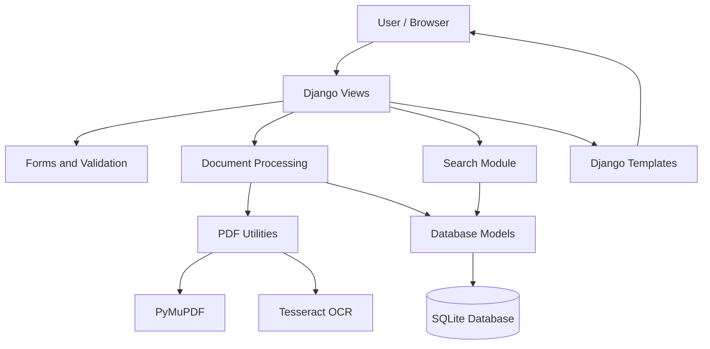
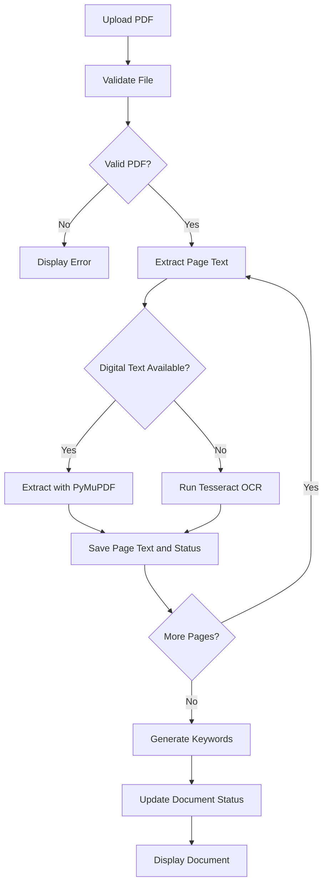
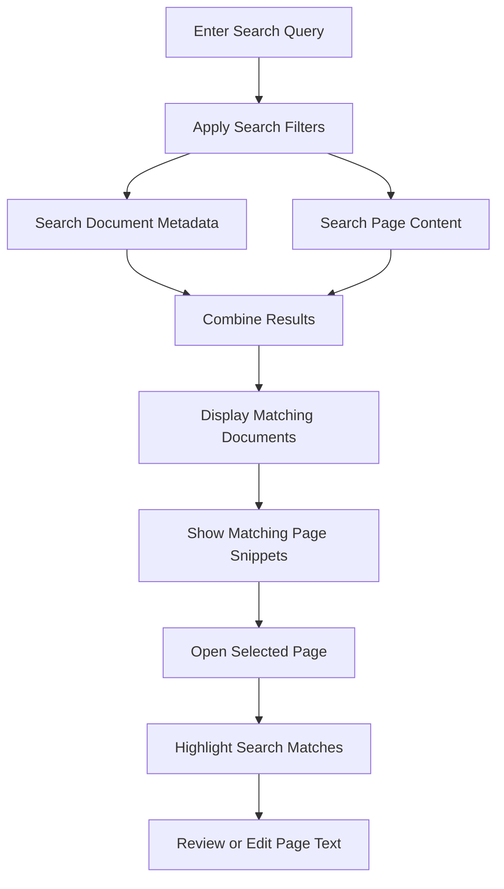
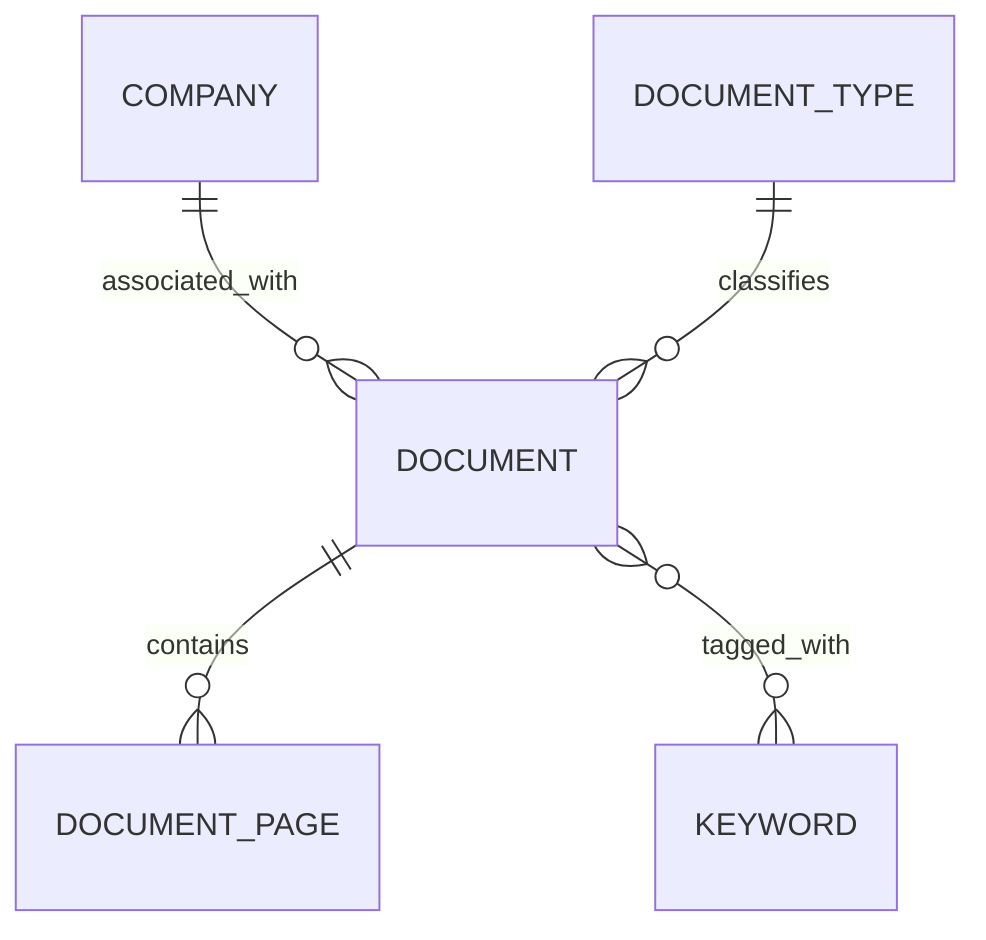

# Legal Document Workbench
**Live Application:** [http://16.171.13.28/](http://16.171.13.28/)
**GitHub Repository:** [shravanbpatel954/legal-doc-workbench](https://github.com/shravanbpatel954/legal-doc-workbench)

A Django-based legal document management system that allows users to upload PDF documents, extract text using PyMuPDF and Tesseract OCR, review extracted content, and search across documents and individual pages.

The project combines **document intake, OCR processing, and legal document search** in a single application.

## Features

- Upload and validate PDF documents.
- Extract digital text using PyMuPDF and scanned text using Tesseract OCR.
- Automatically suggest document titles, companies, and document types.
- Store extracted text and processing status for each page.
- Edit and correct extracted page text.
- Retry failed page processing.
- Search documents by title, company, type, keywords, document ID, and page content.
- Highlight search matches and navigate between matching pages.
- Track document processing progress.
- Detect duplicate uploads using SHA-256 hashing.

## Tech Stack

| Technology | Purpose |
|---|---|
| Python | Core application logic |
| Django 5 | Backend and web framework |
| SQLite | Database for development |
| PyMuPDF | PDF reading and text extraction |
| Tesseract OCR | Text extraction from scanned pages |
| HTML and CSS | User interface |
| JavaScript | Upload interactions and page updates |

The application uses Django templates and does not require Node.js or a frontend build system.

## Project Structure

```text
backend/
├── manage.py
├── requirements.txt
│
├── legal_dms/
│   ├── settings.py
│   ├── urls.py
│   └── wsgi.py
│
├── library/
│   ├── models.py
│   ├── views.py
│   ├── urls.py
│   ├── forms.py
│   ├── admin.py
│   ├── tests.py
│   │
│   ├── pdf_utils.py
│   ├── processing.py
│   ├── detect.py
│   ├── search.py
│   ├── keywords.py
│   ├── sample_pdfs.py
│   │
│   ├── templates/
│   ├── static/
│   ├── templatetags/
│   ├── migrations/
│   │
│   └── management/
│       └── commands/
│           ├── seed_sample_data.py
│           └── make_sample_pdfs.py
│
└── media/
    └── documents/
```

*Note: The structure above represents the intended layout. `media/documents/` is created or populated as needed, depending on the configured file storage.*

## Main Modules

| File | Responsibility |
|---|---|
| `manage.py` | Django project management commands |
| `legal_dms/settings.py` | Project settings, database, media, static files, and OCR configuration |
| `legal_dms/urls.py` | Main URL routing |
| `library/models.py` | Database models for documents, pages, companies, document types, and keywords |
| `library/views.py` | Handles upload, search, document review, editing, and retry requests |
| `library/urls.py` | Routes for the document management application |
| `library/forms.py` | Upload forms, document editing forms, and input validation |
| `library/pdf_utils.py` | PDF validation, hashing, text extraction helpers, and OCR utilities |
| `library/processing.py` | Page-by-page extraction, OCR processing, and retry handling |
| `library/detect.py` | Rule-based company and document type detection |
| `library/search.py` | Document search, filtering, and matching-page retrieval |
| `library/keywords.py` | Automatic keyword generation |
| `library/admin.py` | Django admin configuration |
| `library/tests.py` | Automated tests |
| `library/templates/` | HTML templates for application screens |
| `library/static/` | CSS and JavaScript assets |
| `library/templatetags/` | Custom template filters, including search highlighting |
| `library/migrations/` | Database schema migrations |
| `library/management/commands/` | Commands for sample data and test PDF generation |

## System Architecture

The application follows a modular Django architecture. Views handle HTTP requests, while document processing, detection, and search are implemented in separate Python modules.



## Workflow 1: Document Upload and Processing



## Workflow 2: Document Search and Review



## Data Model

The application stores document metadata separately from individual page content.



- **Company:** Stores company names.
- **DocumentType:** Stores document categories.
- **Document:** Stores file information, metadata, upload details, and processing status.
- **DocumentPage:** Stores page-wise extracted text, OCR confidence, processing status, and corrected text.
- **Keyword:** Stores automatically generated search keywords.

Each document page is stored separately, allowing users to search, review, edit, and retry individual pages.

## Installation and Setup

### Prerequisites

- Python 3.11 or newer
- Tesseract OCR installed and available on the system PATH
- Git (optional)

### 1. Clone the Repository

```bash
git clone <repository-url>
cd <repository-folder>/backend
```

### 2. Create a Virtual Environment

```bash
python -m venv env
```

Activate it:

**Windows**
```bash
env\Scripts\activate
```

**Linux / macOS**
```bash
source env/bin/activate
```

### 3. Install Dependencies

```bash
pip install -r requirements.txt
```

### 4. Configure the Application

Configure the database, Django secret key, allowed hosts, and Tesseract executable path in `legal_dms/settings.py` or through environment variables, as appropriate.

### 5. Apply Database Migrations

```bash
python manage.py migrate
```

### 6. Load Sample Data (Optional)

```bash
python manage.py seed_sample_data
python manage.py make_sample_pdfs
```

### 7. Start the Development Server

```bash
python manage.py runserver
```

Open [http://127.0.0.1:8000/](http://127.0.0.1:8000/) in your browser.

## Application Routes

| Route | Description |
|---|---|
| `/` | Document listing and search |
| `/upload/` | Upload a PDF document |
| `/queue/` | View document processing status |
| `/documents/<id>/` | View document details and pages |
| `/documents/<id>/edit/` | Edit document metadata |
| `/documents/<id>/pages/<n>/` | View or edit a specific page |
| `/admin/` | Django administration |

## Design Principles

- **Page-level storage:** Each page has its own extracted text and processing status.
- **Separation of concerns:** Search, PDF processing, detection, and views are maintained in separate modules.
- **Safe text correction:** User-corrected text is stored separately from the original extracted text.
- **Rule-based detection:** Company, document type, and keywords are identified without requiring an LLM.
- **Searchable documents:** Metadata and page content are searchable from a single interface.
